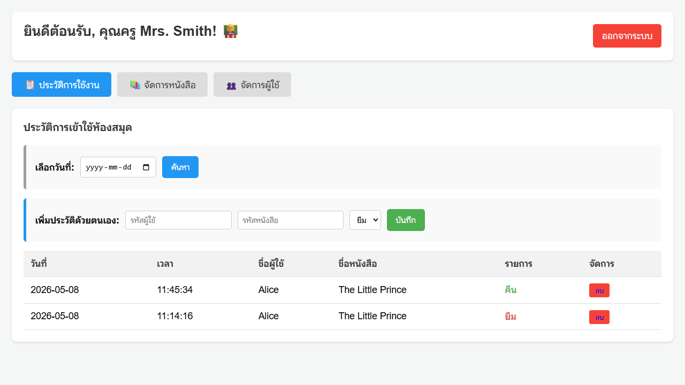

# Simple Library System for my Mother's School

A lightweight, locally hosted library management system built to simplify daily book borrowing and returning for a primary school. Designed specifically to run on a single local computer, it features a clean Thai UI, an intuitive Admin Panel for teachers, and real-time LINE Chat notifications for tracking library activity.

## Overview

This system was created to replace manual paper logs with a reliable digital solution that requires zero cloud infrastructure or recurring server costs. All data is securely stored locally via SQLite, while internet connectivity is only utilized to push instant activity alerts to the school's LINE Group using the LINE Messaging API.

## Features

### Students
*   **Login**: Students log in using their unique ID and a simple PIN.
*   **Borrow**: Enter a Book ID to instantly borrow a book. Prevents borrowing books that are already taken.
*   **Returns**: Students see a list of books they currently hold and can return them with a single click.
*   **Security**: Automatic 10-minute session timeout (auto-logout) if the computer is left unattended.
*   **Notifications**: Instantly sends a message to the school LINE Group when a book is borrowed or returned.

### Teachers
*   **Logs**: View all library transactions (Borrow/Return) with a built-in Date Picker to filter history.
*   **Book Management**: Add new books or delete lost ones. Automatically handles multiple copies of the same title while preventing duplicate barcode IDs.
*   **User Management**: Add or remove student and teacher accounts directly from the UI (includes safety checks to prevent deleting your own account).
*   **Manual Override**: Teachers can manually log a borrow/return action if a student forgets to do it.

## Tech

*   **Backend**: Python 3, Flask
*   **Database**: SQLite (Local `.db` file)
*   **Frontend**: HTML5, CSS3, Vanilla JavaScript (No heavy frameworks required)
*   **API Integration**: LINE Messaging API (Push Notifications)
*   **Localization**: Fully translated Thai User Interface
